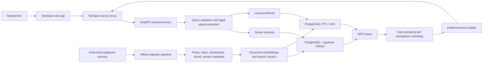

# Nyayalens - Semantic Search Execution Plan

## 1. Outcome and non-negotiable scope

Build a real, auditable precedent-retrieval system for first-pass legal research. A user enters a natural-language case description; the system returns unique Supreme Court and High Court judgments ranked by a measured hybrid retrieval pipeline, with exact source passages, verified metadata, transparent match reasons, and a link to the original judgment.

The product retrieves and explains precedents. It does not predict outcomes, recommend whether relief should be granted, generate legal holdings, or guarantee that a precedent remains good law. Human verification remains mandatory.

The existing sober React/TanStack interface should be retained and refined. The work is primarily a data, retrieval, evidence, evaluation, and safety implementation—not a visual redesign.

## 2. What the supplied feedback requires

All three supplied PDFs were reviewed page by page (49 pages total). Their recurring requirements are:

1. Demonstrate one complete query-to-result path: anonymized query, extracted legal signals, ranked real judgment, exact matched passage, match reasons, and source verification.
2. Replace illustrative relevance percentages with rankings produced by a real retrieval pipeline.
3. Compare lexical-only, dense-only, and hybrid retrieval on the same frozen labelled query set.
4. Use nDCG@10 as the primary metric, supported by Precision@5, Recall@10, MRR@10, p95 latency, and source-link coverage.
5. Preserve exact statutes, sections, citations, court/date metadata, and passage-level provenance.
6. Use dense and lexical retrieval together, fuse ranks with Reciprocal Rank Fusion (RRF), group passages back into unique cases, and show extractive evidence.
7. Use only authorized public sources and retain source URLs, retrieval timestamps, checksums, parser status, corpus version, model version, and index version.
8. Treat citation/overruling detection cautiously: demonstrate a limited citation-treatment warning only if supported by source text; otherwise label it as roadmap.
9. Support privacy, auditability, failure recovery, a no-result state, and an offline demonstration path.
10. Keep claims honest: similarity is not legal accuracy, a ranking score is not a probability, and source verification is not proof of present validity.

## 3. Implemented keyless baseline versus production target

The first executable baseline was completed on 22 August 2026 and expanded to the current 4,609-judgment corpus on 26 August 2026. It deliberately uses a lightweight local ONNX model, exact NumPy cosine search and SQLite FTS5 so it can be demonstrated without a paid service or API key. The PostgreSQL/pgvector and larger-model design below remains the scale-up target, not a claim about what is already deployed.

| Area             | Implemented baseline                                                                                                                     | Production target                                                                                 |
| ---------------- | ---------------------------------------------------------------------------------------------------------------------------------------- | ------------------------------------------------------------------------------------------------- |
| Retrieval        | Two BGE-small vectors per judgment (facts and decision) + SQLite FTS5 over 151,653 passages                                              | Expand the versioned, licensed corpus; use PostgreSQL/pgvector when scale requires it             |
| Ranking          | Judgment-level RRF(k=60), passage-role/context reranking, contradiction checks and authority tie-breaker                                 | Tune weights on a lawyer-reviewed labelled set and retain only measurable improvements            |
| Evidence         | Query-focused extractive summary, primary passage locator, ranking basis and source link                                                 | Automated provenance checks, immutable source versions and citation coverage reporting            |
| Outcome/relation | Conservative extractive matter/trial status and winner fields; ambiguous cases say verify                                                | Add only reviewer-approved structured treatment signals and maintain abstention rules             |
| Filters          | Structured filters validated in TypeScript and Python and applied to both branches                                                       | Expand facets with corpus-backed metadata and facet-level regression tests                        |
| Corpus           | 4,609 source-linked Supreme Court and High Court judgments, version `import-2026-08-24-4609-cases`                                       | Authorized, independently reviewed and deduplicated corpus snapshots                              |
| Source links     | Public original-judgment link returned for every result                                                                                  | Store retrieval timestamp, checksum, parser status and independent link monitoring                |
| Evaluation       | Four versioned regression queries with dense/lexical/hybrid judged precision, coverage, MRR, Recall, condensed nDCG and pairwise metrics | 30-50 lawyer-reviewed queries, negatives, adversarial cases, p95 latency and confidence intervals |
| Validity         | Unsupported claim surface                                                                                                                | Cautious citation-treatment flag or explicit roadmap                                              |
| Security         | Committed upstream token removed; no external query API; optional service secret                                                         | Revoke the previously exposed token, then add authentication, rate limiting and audit controls    |
| Reliability      | Request sequencing, typed contracts, health endpoint, offline runtime and regression tests                                               | Add operational monitoring, retry policy, backups and corpus/index rollback                       |
| Recent cases     | Misleading static section removed and replaced with a corpus overview                                                                    | Add only when it is generated from verified, dated corpus records                                 |

## 4. Target architecture



### Deployment decision

Keep the existing TanStack Start/Cloudflare web application. Add a separate Python retrieval service because local embedding inference, ingestion, PDF parsing, and PostgreSQL/pgvector do not fit a Cloudflare Worker runtime. The TanStack server function becomes a thin authenticated proxy so browser clients never receive database credentials or upstream-source secrets.

For the hackathon/offline path, run the retrieval service, PostgreSQL/pgvector, and precomputed model/index bundle with Docker Compose. For hosted use, deploy the Python service and PostgreSQL on a compatible container platform; keep the web app on its current deployment.

## 5. Proposed repository layout

```text
precedent-finder-demo/
  src/
    api/search.ts                 # validated TanStack proxy
    contracts/search.ts          # shared request/response schemas
    routes/index.tsx              # query/result orchestration
    components/legal/             # sober search, filter, evidence UI
  services/retrieval/
    app/main.py                   # FastAPI app and lifecycle
    app/api/search.py             # POST /search
    app/api/cases.py              # GET /cases/{id}
    app/api/feedback.py           # POST /feedback
    app/core/config.py
    app/core/security.py
    app/ingestion/                # acquire, parse, clean, dedupe, chunk
    app/extraction/               # citations, statutes, court, posture signals
    app/embeddings/               # model loading and batching
    app/retrieval/                # dense, lexical, RRF, grouping, reranking
    app/evaluation/               # datasets, metrics, comparison reports
    app/db/                       # models, repositories and migrations
    tests/
  data/
    manifests/                    # corpus/index/model manifests only
    evaluation/                   # versioned queries and labels, no private data
  infra/
    compose.yaml
    postgres/init.sql
  docs/
    semantic-search-execution-plan.md
    data-provenance.md
    evaluation-report.md
    demo-runbook.md
```

Do not commit downloaded judgment files, private petitions, model weights, `.env` files, or API keys. Keep a manifest and a reproducible acquisition command instead.

## 6. Phase 0 - Stop misleading or unsafe behavior

Complete this before adding semantic retrieval.

### Changes

- Rotate the exposed Indian Kanoon token. Remove the literal fallback and all `VITE_INDIAN_KANOON_API_KEY` reads; accept only a server-side secret.
- Replace identity validators with runtime schemas: query length, allowed court/year/issue values, `topK`, and document IDs.
- Add request timeouts, bounded concurrency, rate limiting, caching, safe client errors, and structured server logs without raw confidential query text.
- Remove the unfiltered fallback that returns results contradicting selected filters.
- Add request cancellation or monotonically increasing request IDs so stale searches cannot overwrite newer results.
- Remove fabricated relevance percentages, “semantic vector” claims, inferred outcomes, and the hard-coded “supports” relation until the real engine provides evidence.
- Correct court-source parsing and support `Unknown/Other` rather than defaulting everything to High Court.
- Replace static “Recent/This week/Last month” records with verified corpus data or temporarily remove the section.
- Fix all TypeScript errors and add `typecheck`, `test`, and CI scripts. Keep lint warnings separate from failures.

### Exit gate

- No secret exists in tracked source or client bundles.
- The current UI makes only claims the implementation can prove.
- Build, type-check, lint, and tests pass.
- Filters, no-result behavior, errors, and overlapping searches behave deterministically.

## 7. Phase 1 - Define an authorized, reproducible corpus

### Initial legal scope

Start narrow enough to label and verify well:

- regular bail and personal liberty;
- land/property disputes;
- cheque-bounce matters.

Use 200-500 verified public Supreme Court/High Court judgments for the first credible corpus. A 50-200 judgment slice is acceptable for the first working milestone. Add other categories only after data coverage and evaluation exist; do not show empty or synthetic category counts.

### Source policy

- Preferred: eSCR/Supreme Court and authorized eCourts judgment sources.
- Indian Kanoon API may be used only under its current terms and as an acquisition/source-link provider; never scrape it without authorization.
- Law Commission and government reports may support research claims but must not be indexed as precedent judgments.
- Record the canonical URL, source name, access/retrieval time, court, date, title, case number/citation, file hash, content hash, license/terms note, parser version, and parse status.
- Preserve raw and cleaned forms separately so every indexed passage is traceable.

### Corpus manifest

Each frozen corpus version records:

- corpus ID and creation time;
- source inventory and checksums;
- included/excluded records and reasons;
- parser/OCR/chunking versions;
- embedding model, dimension, instruction and normalization;
- lexical configuration;
- database migration and index parameters.

### Exit gate

- Every indexed case has a verified public source URL and checksum.
- Duplicate judgments are resolved to one stable internal case ID.
- Parse failures and missing metadata are visible, not silently accepted.

## 8. Phase 2 - Build the offline ingestion pipeline

### Ordered pipeline

1. **Acquire:** download only approved sources; verify response type, size, checksum and provenance.
2. **Parse:** extract text from HTML/text PDFs; route scanned PDFs through optional OCR; retain paragraph/page references.
3. **Clean:** remove repeated headers/footers and normalize whitespace without rewriting legal text.
4. **Deduplicate:** combine source hash, content hash, case number, title/court/date and citation aliases.
5. **Segment:** detect case header, facts, issues, arguments, analysis, cited precedents, decision/order where reliably available.
6. **Extract metadata:** court, bench, date, case number, citations, acts, sections, procedural posture, matter type and citation references.
7. **Chunk:** create case -> section -> passage hierarchy. Start at 600-900 tokens with 80-120 token overlap; never split a paragraph when avoidable.
8. **Embed:** encode document passages once, in batches, using a frozen model configuration.
9. **Index:** write relational metadata, full-text vectors and embeddings in one transaction; create versioned indexes.
10. **Validate:** sample passages against original sources and produce a parse/index report.

### Extraction strategy

Use deterministic regex/spaCy-style rules and dictionaries for citations, statutes, sections, court names and common procedural terms. Store extraction confidence and error flags. Do not silently “correct” a citation or generate missing metadata. A legal reviewer should verify golden-demo records.

### Exit gate

- A randomly sampled set of chunks can be traced to the exact source page/paragraph.
- Re-running ingestion with the same inputs/config produces the same case IDs and manifest.
- Golden-demo metadata and evidence are manually verified.

## 9. Phase 3 - Database and indexes

Use PostgreSQL 16+ with pgvector. Start with exact vector search for the tiny corpus and enable HNSW only when measurements justify it.

### Core tables

#### `legal_cases`

`case_id`, `source_document_id`, `title`, `court`, `court_level`, `bench`, `decision_date`, `case_number`, `canonical_citation`, `citation_aliases`, `matter_type`, `procedural_posture`, `source_url`, `source_name`, `source_hash`, `content_hash`, `retrieved_at`, `metadata_json`, `quality_flags`, `corpus_version`

#### `case_chunks`

`chunk_id`, `case_id`, `section_type`, `section_heading`, `paragraph_start`, `paragraph_end`, `page_start`, `page_end`, `chunk_index`, `chunk_text`, `token_count`, `search_tsv`, `embedding`, `chunk_hash`, `parser_version`, `embedding_version`

#### `case_citations`

`source_case_id`, `target_case_id`, `raw_citation`, `normalized_citation`, `source_passage`, `treatment_signal`, `treatment_confidence`, `review_status`

#### `search_runs`

`run_id`, redacted/query hash fields, structured filters, corpus/model/index versions, dense candidates, lexical candidates, fused ranks, result case IDs, latency breakdown, created time. Raw private queries should not be retained by default.

#### `relevance_feedback`

`query_id/run_id`, `case_id`, relevance label, reviewer role, uncertainty/comment, created time. Separate evaluation labels from casual user feedback.

### Indexes

- HNSW cosine index on normalized embeddings when the corpus is large enough.
- GIN index on `search_tsv` for PostgreSQL full-text lexical retrieval.
- B-tree indexes on court, date, matter type, case ID, source ID and corpus version.
- Unique constraints on stable case/source/content identifiers.

### Exit gate

- Database migrations can create an empty system and load a frozen corpus.
- Exact-search recall is used as the correctness reference before approximate HNSW tuning.

## 10. Phase 4 - Query understanding

### Validation and privacy

- Require meaningful content; set a conservative maximum length.
- Warn users not to enter names or confidential identifiers in the prototype.
- Apply optional local redaction for emails, phone numbers, addresses and common party-name patterns before logging; search the original in memory only when policy permits.
- Never interpolate user text into SQL or raw query syntax.

### Extracted search signals

- material facts and chronology;
- requested relief;
- procedural posture/investigation status;
- acts and section numbers;
- evidence type;
- court and date preference;
- matter type;
- flight, witness, custody and delay factors where present.

Show these as editable/inspectable chips only when confidently extracted. They improve filters and explanations; they are not a generated legal opinion.

### Embedding configuration

Start with `Qwen/Qwen3-Embedding-0.6B`, normalized query/document vectors, a frozen task instruction, and 1024 dimensions. Its official model card supports instruction-aware multilingual retrieval and 1024-dimensional output. Benchmark it against at least one smaller multilingual/SentenceTransformer baseline on the labelled Indian legal query set; choose the model by quality/latency evidence, not popularity.

### Exit gate

- Golden queries produce deterministic extracted signals.
- Query/document embeddings use the same frozen model, dimension, normalization and document policy.

## 11. Phase 5 - Hybrid retrieval and ranking

### Candidate generation

1. Apply hard structured filters—court/date/matter type—consistently to both branches when possible.
2. Dense branch: retrieve top 50-100 passages by cosine similarity.
3. Lexical branch: retrieve top 50-100 passages using PostgreSQL FTS (`websearch_to_tsquery`/controlled query construction and `ts_rank_cd`) plus exact citation/section matching.
4. Do not call PostgreSQL FTS “BM25.” Add Elasticsearch/OpenSearch only if a measured experiment needs exact BM25.

### Fusion

Use Reciprocal Rank Fusion rather than mixing incomparable raw scores:

`RRF(item) = sum(1 / (k + rank_in_list))`, starting with `k = 60` and validating it.

Fuse at passage level, then group by `case_id` so one long judgment cannot occupy several result slots. Use the best passage as primary evidence and retain one or two supporting passages.

### Transparent reranking

Start with rules that can be shown to a user:

- RRF base rank;
- exact section/citation overlap;
- matter/procedural-posture match;
- explicit active filter match;
- court/date metadata shown separately, not hidden as an unexplained authority boost.

Do not add a cross-encoder until the zero-shot hybrid baseline is stable and evaluation demonstrates a need. If added, rerank only a small candidate set, version the model, record latency and compare metrics.

### Scores shown in UI

- Primary display: rank and plain-language reason codes.
- Optional: label raw values as “similarity signal” or “retrieval score,” never “legal accuracy” or probability.
- Do not show percentages until a documented calibration method exists; even then, do not imply legal correctness.

### No-match behavior

If confidence/evidence rules are not met, return an explicit no-match/low-confidence response with query-refinement guidance. Never broaden filters silently or invent a precedent.

### Exit gate

- Different golden queries change rankings in expected, reviewable ways.
- Dense, lexical and hybrid results can be reproduced from a stored run manifest.
- Duplicate cases never occupy multiple top-result slots.

## 12. Phase 6 - Evidence-first result contract

### API surface

#### `GET /health`

Return service/database/model readiness plus corpus, model and index versions. Do not expose secrets or internal paths.

#### `POST /search`

Input:

```json
{
  "query": "anonymized case facts",
  "filters": {
    "courtLevels": ["Supreme Court", "High Court"],
    "yearFrom": 2018,
    "yearTo": 2026,
    "matterTypes": ["Bail"]
  },
  "topK": 10
}
```

Output includes `runId`, version metadata, extracted signals, latency, and results. Each result includes:

- stable case ID and rank;
- verified title, court, date, case number/citation and source URL;
- exact matched passage plus page/paragraph/section locator;
- shared facts/issues only when tied to indexed signals;
- dense rank, lexical rank, fused rank and transparent reason codes;
- alternative supporting passage(s);
- explicit human-verification warning;
- cautious citation-treatment warning only if source text supports it.

#### `GET /cases/{id}`

Return verified metadata, indexed passages, provenance and the original-source action.

#### `POST /feedback`

Accept a result-level relevance label and optional comment without storing confidential case facts.

### Evidence rules

- Use extractive passages only for the MVP.
- Never manufacture an outcome or holding from a search snippet.
- Highlight exact overlapping terms without changing the passage text.
- Every evidence item must carry a source locator and corpus version.

### Exit gate

- 100% of displayed results have working verified source links and exact stored evidence.
- API schemas are shared/validated at both the proxy and service boundary.

## 13. Phase 7 - Integrate with the current sober UI

### Keep

- existing navy/off-white legal visual system;
- natural-language textarea;
- two-column result/filter layout;
- restrained result list and expandable “Why it matched” section;
- accessibility-first keyboard and responsive behavior.

### Change

- Replace the current Indian Kanoon server function with the validated retrieval-service proxy.
- Manage search via TanStack Query with a key containing the query, filters and corpus version; cancel superseded requests.
- Add a short privacy note next to the textarea: use anonymized facts; do not enter privileged/confidential data.
- Show extracted signals between the query and results so the worked flow is visible.
- Replace relevance percentages with rank plus reason codes such as “semantic passage match,” “Section 439 exact match,” and “procedural posture match.”
- Make matched evidence the most prominent content after title/metadata.
- Show “Verify in original judgment” as the primary secondary action.
- Add corpus/model freshness and limitations in a small technical-details disclosure, not a flashy dashboard.
- Make filters deterministic and display active-filter chips.
- Provide explicit loading, no-result, low-confidence, timeout and service-unavailable states.
- Replace static recent cases with verified indexed judgments or hide the section until the corpus supports it.

### Accessibility and professional-use details

- announce result counts/loading/errors with an ARIA live region;
- retain visible focus states and proper fieldset/legend semantics;
- keep evidence and disclaimers visible on mobile;
- allow copy citation and copy source-linked passage;
- avoid animations beyond short loading/expand transitions;
- do not add a chatbot, case-outcome prediction, decorative AI graphics or marketing claims.

### Exit gate

- A judge can understand query -> extracted signals -> ranked precedent -> exact evidence -> source verification without reading architecture documentation.
- Mobile, keyboard and screen-reader smoke tests pass.

## 14. Phase 8 - Measurable evaluation

### Dataset

- Build 30-50 anonymized natural-language golden queries across the three initial matter types; 10-15 is the minimum pilot milestone.
- A legally informed reviewer labels candidate judgments with graded relevance: `0 = irrelevant`, `1 = partly relevant`, `2 = highly relevant`.
- Record uncertainty and allow adjudication when reviewers disagree.
- Freeze query, corpus and labels before comparing systems.
- Keep golden queries out of model/index tuning where possible; separate development and test subsets as the dataset grows.

### Systems compared on identical inputs

1. lexical-only;
2. dense-only;
3. hybrid RRF;
4. optional reranked hybrid only after the first three are stable.

### Metrics

- **Primary:** nDCG@10.
- **Supporting:** Precision@5, Recall@10, MRR@10.
- **Operational:** p50/p95 end-to-end latency, error rate, no-result rate.
- **Trust:** source-link coverage, evidence-locator coverage, metadata completeness.
- **Analysis:** per-matter/court/language slices and qualitative failure categories.

### Provisional release gates

- source-link and evidence-locator coverage: 100% for displayed results;
- no secret/private query leakage in logs;
- hybrid nDCG@10 must be no worse than the strongest baseline; target at least a 5% relative improvement, but report the observed value honestly;
- p95 search latency under 2 seconds on the declared demo hardware with precomputed document embeddings;
- all five frozen demo queries return reviewer-approved evidence or an honest no-match state;
- no fabricated citation, metadata or passage in the reviewed sample.

Targets must be labelled as targets until the frozen evaluation run produces results. Save raw rankings, configuration, code revision and output CSV/JSON so metrics are reproducible.

### Exit gate

- `evaluation-report.md` contains corpus/query/model versions, raw-run artifact paths, results, limitations and error examples.
- The demo can show one small lexical vs dense vs hybrid comparison without unsupported generalization.

## 15. Phase 9 - Citation graph and precedent-validity roadmap

### MVP proof, only if time remains

1. Extract citation strings from a small manually verified set.
2. Normalize aliases to stable case IDs, retaining raw citations.
3. Build directed `cites` edges.
4. Detect nearby language such as “followed,” “distinguished,” “doubted” or “overruled” with transparent rules.
5. Require manual review before exposing any negative-treatment flag.
6. Display: “Possible negative treatment - verify source,” with the later judgment, exact passage and source link.

A citation edge alone does not prove positive or negative treatment. Absence of a flag does not prove validity. Never show an automated “valid precedent” checkmark.

### Exit gate

- If a complete, manually verified warning example cannot be demonstrated, the UI contains no validity claim and documentation labels this as roadmap.

## 16. Phase 10 - Security, privacy, reliability and operations

### Controls

- secrets only in deployment secret stores; rotate the already-exposed token;
- HTTPS, strict CORS/service authentication between web proxy and retrieval service;
- typed/parameterized database access;
- request size limits, query/filter schemas, rate limits, timeouts and bounded upstream calls;
- no raw query logging by default; redact identifiers and document retention policy;
- audit fields: run ID, corpus/model/index version, ranks, source IDs and latency—not private text;
- source/license inventory and terms review;
- backups and migration rollback for PostgreSQL;
- dependency pinning and vulnerability scanning;
- health/readiness checks and structured error categories;
- corpus/model warm-up and cached golden queries for offline demonstration;
- bias/coverage reporting by court, date, matter type and language.

### Failure behavior

- model unavailable: use a clearly disclosed lexical-only mode only if prepared and evaluated;
- database unavailable: show service-unavailable, never stale invented results;
- source site unavailable: use the stored authorized passage and retain the original URL;
- no result: abstain and help refine the query;
- irrelevant result: preserve the run for error analysis and accept a relevance label;
- offline demo: run the frozen local corpus, model and database with no external API dependency.

## 17. Testing strategy

### Unit tests

- query/filter schemas and privacy redaction;
- citation/statute/court/date extraction;
- chunk boundaries and source locators;
- deterministic IDs and deduplication;
- normalized embeddings and dimension checks;
- lexical query construction;
- RRF formula and tie-breaking;
- case grouping and reason-code generation;
- no-match and citation-warning rules.

### Integration tests

- ingest a small fixture corpus into PostgreSQL;
- verify dense, lexical and hybrid candidate sets;
- verify hard filters apply to both retrieval paths;
- ensure every result joins to source metadata and evidence;
- test migrations, health checks, timeouts and rate limits;
- ensure server secrets do not appear in browser bundles.

### End-to-end tests

- submit a golden query and inspect a source-linked result;
- change filters rapidly and confirm stale requests cannot win;
- empty/poor query, no-result, offline and service-error paths;
- keyboard/mobile/accessibility flows;
- source link and copy-citation/passage actions.

### Regression evaluation

Run the frozen query set in CI or a scheduled evaluation whenever model, chunking, corpus, extraction, index parameters, filters, fusion or reranking changes. Fail the release if source coverage falls below 100% or the agreed quality/latency regression threshold is crossed.

## 18. Execution sequence and deliverables

### Milestone A - Honest foundation

Deliverables: rotated secret, corrected claims, deterministic filters/search state, type-safe build, tests, source-backed UI only.

### Milestone B - Searchable verified corpus

Deliverables: 50-200 verified judgments, ingestion pipeline, manifest, PostgreSQL schema, chunks, metadata, precomputed embeddings and lexical index.

### Milestone C - Real hybrid search

Deliverables: FastAPI service, dense/lexical retrieval, RRF, case grouping, typed API, TanStack integration and source-linked evidence cards.

### Milestone D - Feedback proof

Deliverables: five golden demo queries, 10-15 labelled pilot queries, lexical/dense/hybrid report, honest metric labels and one complete worked example.

### Milestone E - Hardened evaluation build

Deliverables: 30-50 queries, reviewer labels, reproducible evaluation, privacy/security controls, offline Compose bundle, recovery runbook and accessibility verification.

### Milestone F - Optional validity proof

Deliverables: small manually verified citation graph and cautious treatment warning—or an explicit roadmap with no misleading UI claim.

## 19. Definition of done

The implementation is ready for evaluation only when all of the following are true:

- a real query changes the ranking over a real frozen public corpus;
- dense, lexical and RRF hybrid retrieval all run and can be compared;
- each displayed result is a unique case with verified metadata, exact evidence and working source link;
- no relevance percentage or legal-validity claim is fabricated;
- filters are enforced, and the system abstains instead of silently broadening;
- one worked example is manually verified end to end;
- a labelled pilot reports nDCG@10, Precision@5, Recall@10, MRR@10, p95 latency and source-link coverage;
- model, corpus, chunk policy, indexes and raw rankings are versioned and reproducible;
- private query text and secrets are not exposed or retained by default;
- build, type-check, lint, unit, integration and end-to-end checks pass;
- the UI remains restrained, accessible and useful to lawyers/judicial staff;
- implemented capabilities and roadmap items are clearly separated;
- the offline demo can complete the golden path without an external API.

## 20. Helpful additions that remain relevant

These additions improve legal-research utility without turning the product into a flashy or unsafe feature set:

1. **Editable extracted-signal chips** so a researcher can correct a statute, posture or court interpretation before searching.
2. **Copy source-linked passage** with citation and locator, reducing transcription errors.
3. **Corpus coverage disclosure** by court, year, matter and language, preventing false assumptions about missing results.
4. **Result feedback labels** (“relevant,” “partly relevant,” “not relevant”) stored separately from confidential queries and reusable for evaluation.
5. **Saved reproducible search run** containing versions and result IDs, not raw confidential facts.
6. **Side-by-side evidence passages** only when two passages from the same judgment materially explain the match; avoid general result comparison dashboards.
7. **Query-quality guidance** that asks for facts, statute, procedural posture and requested relief, without generating legal advice.
8. **Source freshness and parse-quality badges** based on actual manifests/flags rather than decorative confidence indicators.

## 21. Technical source checks

- Qwen3-Embedding-0.6B official model card: https://huggingface.co/Qwen/Qwen3-Embedding-0.6B
- pgvector official project and hybrid-search guidance: https://github.com/pgvector/pgvector
- PostgreSQL full-text search ranking: https://www.postgresql.org/docs/current/textsearch-controls.html
- PostgreSQL GIN indexes: https://www.postgresql.org/docs/current/gin.html
- Indian Kanoon API documentation and allowed endpoints: https://api.indiankanoon.org/documentation/
- Supreme Court eSCR search: https://scr.sci.gov.in/scrsearch/

These sources must be rechecked before implementation is frozen because APIs, versions and terms can change.
